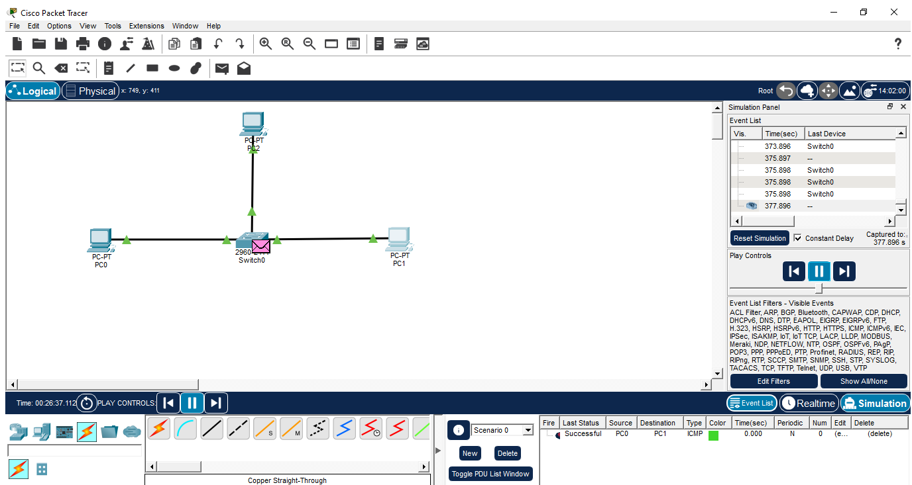
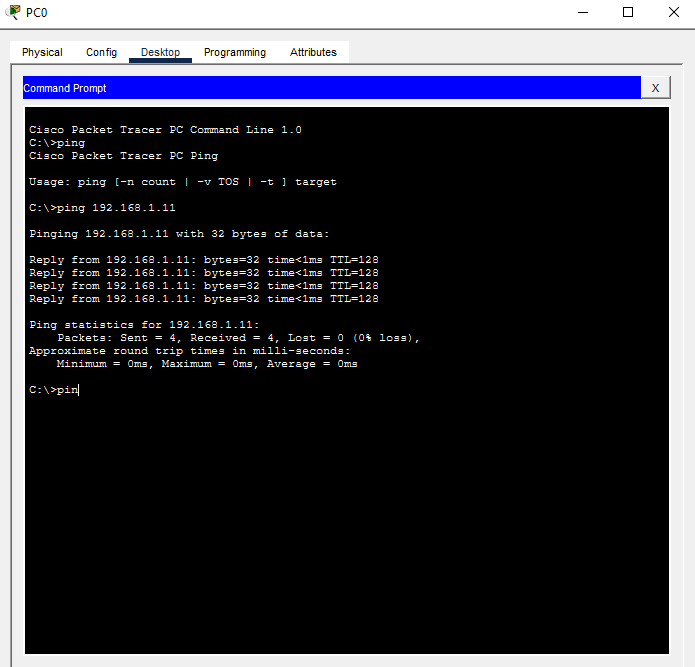

# Lab 00: Your First Ping


## 🎯 Goal
Connect two PCs through a switch, give each one an IP address, and make them ping each other.

## 🗺️ Topology

```
 PC0 ──────── Switch (2960) ──────── PC1
   Fa0      Fa0/1        Fa0/2       Fa0
```

## 📋 Addressing Table

| Device | Port | IP Address | Subnet Mask |
|---|---|---|---|
| PC0 | FastEthernet0 → Switch Fa0/1 | 192.168.1.10 | 255.255.255.0 |
| PC1 | FastEthernet0 → Switch Fa0/2 | 192.168.1.11 | 255.255.255.0 |

## 🔧 What I did

1. **Placed the devices:** 2 PCs and a Cisco 2960 switch.
2. **Cabled them** with Copper Straight-Through cables: PC0 Fa0 → Switch Fa0/1, PC1 Fa0 → Switch Fa0/2.
3. **Waited for the links to come up.** Both link lights turned green after about 30 seconds.
4. **Set static IPs** under Desktop → IP Configuration on each PC (see the table above).
5. **Tested connectivity** from PC0's Command Prompt:

```
C:\> ping 192.168.1.11
```

✅ **Result:** PC1 replied. The first request can time out while ARP resolves the MAC address; after that every ping succeeds.

## 📸 Evidence



Screenshot from Cisco Packet Tracer (Simulation mode): every link light is green, and the PDU list at the bottom right shows an ICMP ping from **PC0 → PC1** with status **Successful**. I also added a third PC (PC2) to the switch while experimenting.



From PC0's Command Prompt, `ping 192.168.1.11` got **4 replies out of 4 (0% loss)**, with round-trip times under 1 ms.

## 🧪 Breaking it on purpose
I changed PC1's IP to `192.168.2.11` and pinged again. **It failed**, because the PCs were now on different networks (`192.168.1.0/24` vs `192.168.2.0/24`). A switch can't connect two different networks; that needs a **router**, which is the next lab.

## 💡 What I learned
- A **switch** connects devices on the **same network**.
- Every device needs a **unique IP address**.
- With a `255.255.255.0` mask, devices are on the same network when the **first three octets match** (`192.168.1.x`).
- **Ping** tests whether two devices can reach each other.

## 🩺 Troubleshooting

| Problem | Fix |
|---|---|
| Link light stays red or amber | Wait 30 seconds; make sure it's a straight-through cable |
| `Request timed out` every time | Re-check both IP addresses and masks for typos |
| `Destination host unreachable` | The PCs are on different networks; make the first three octets match |

## 📁 Files
- [`Lab0_First_Ping.docx`](./Lab0_First_Ping.docx): the full lab write-up
- [`lab0-topology.png`](./lab0-topology.png): screenshot of the topology and the successful ping
- [`lab0-ping.png`](./lab0-ping.png): PC0 Command Prompt showing 4/4 ping replies

## ⏭️ Next
- **Lab 01:** add a router and connect two networks
- **Lab 02:** DHCP, so PCs get their addresses automatically
- **Lab 03:** VLANs

---
[← Back to all labs](../)
